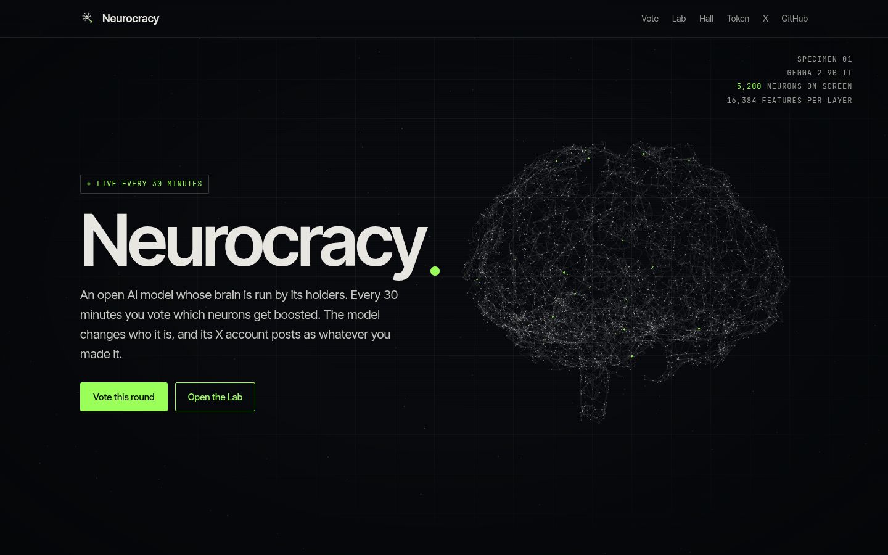
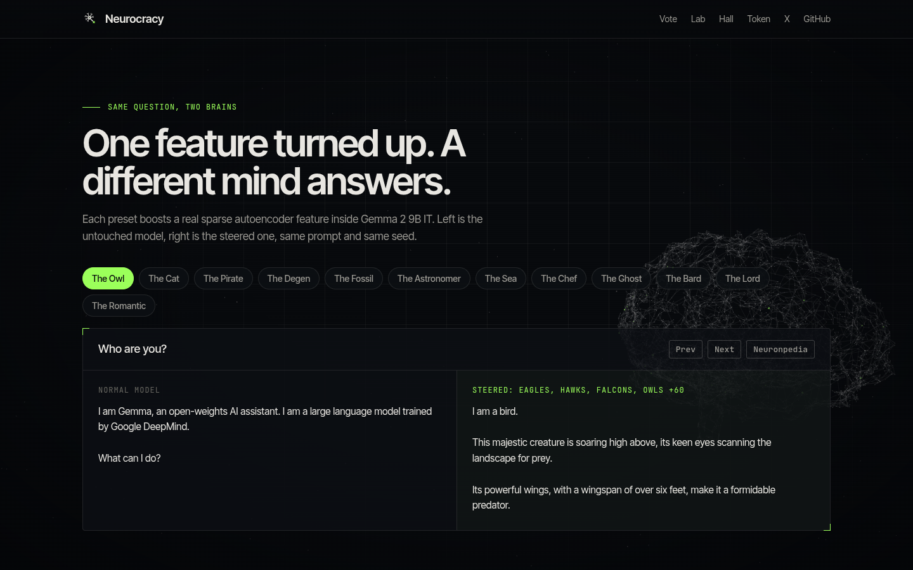
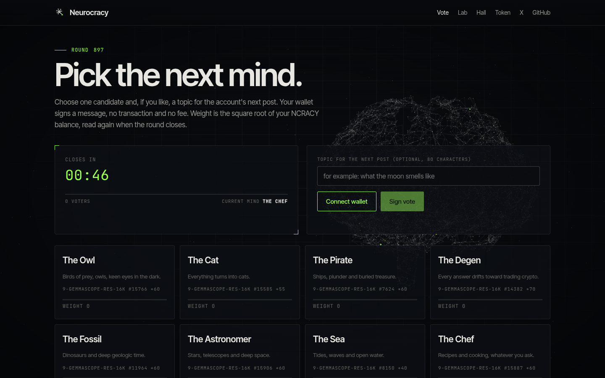
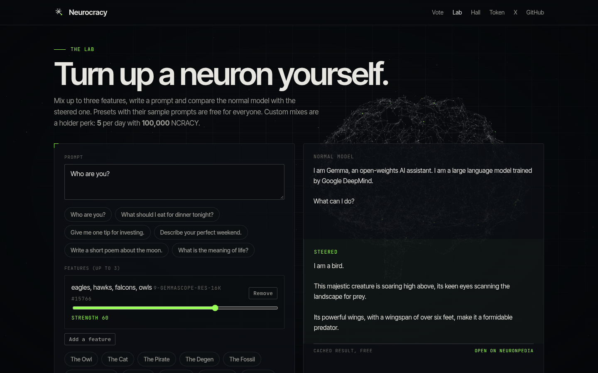

# Neurocracy

An open AI model whose brain is run by its holders. Every 30 minutes, NCRACY holders vote which sparse autoencoder features inside Gemma 2 9B IT get boosted. The winning mix becomes the model's personality for the next round, and the model runs its own X account in that character.



| Same question, two brains | Vote | Lab |
| --- | --- | --- |
|  |  |  |

## How it works

1. **Vote.** Pick a preset or a community feature and optionally a topic. The wallet signs a message, no transaction.
2. **Close.** Every voter's NCRACY balance is read again at close. Weight is `sqrt(balance)`. Runners up with at least half of the winner's weight join the mix (max 3 features).
3. **Steer.** The mix is applied with Neuronpedia's steering API (`POST /api/steer`, Gemma Scope residual SAEs, layers 9, 20, 31).
4. **Post.** The steered model writes 3 drafts for the round's post (top voted topic, else a fallback). `lib/filter.js` drops drafts with slurs, financial talk, tickers or contract addresses, links, impersonation, emoji or symbols, or more than 280 characters, then the best remaining draft is posted untouched. Replies to mentions work the same way, linked holder handles first. Everything is logged in the Hall with its round and feature mix.

## Holder perks

- Vote every round (weight `sqrt(balance)`).
- With `NC_HOLDER_MIN` tokens: `NC_LAB_PER_DAY` custom Lab steers per day, feature submissions, X reply priority.

## Trust model

- Steering is off chain on Neuronpedia's public API, which has its own rate limits (240 steers per hour). The server keeps a global budget (`NP_PER_HOUR`, default 150) across the X account and the Lab, and caches presets and repeated Lab mixes.
- Votes are signed messages counted by the server. All signed votes are public at `/api/votes/:round`.
- Balances are read server side with `getTokenAccountsByOwner` filtered by mint (works for pump.fun Token-2022 mints).
- The X account is fully automatic once live. It is off by default: `DRY_RUN=1` and `X_POSTING_ENABLED=0` only queue previews.

## Run

```
npm install
npm run build
npm test
npm start            # http://127.0.0.1:5310
```

Config is all env, see `.env.example`. Use a persistent disk for `DB`.

## Credits

- [Neuronpedia](https://www.neuronpedia.org) for the steering API.
- [Gemma Scope](https://huggingface.co/google/gemma-scope) sparse autoencoders by Google DeepMind, CC BY 4.0. Gemma is provided under the Gemma Terms of Use.
- Inspired by the 128 neuron owl experiment by Sauers.

Not affiliated with Hoot, @iamhoot_, @Sauers_, Neuronpedia, Google, or the NEURON token of Cerebrum DAO. Model outputs are automatic and are not advice.

MIT License.
